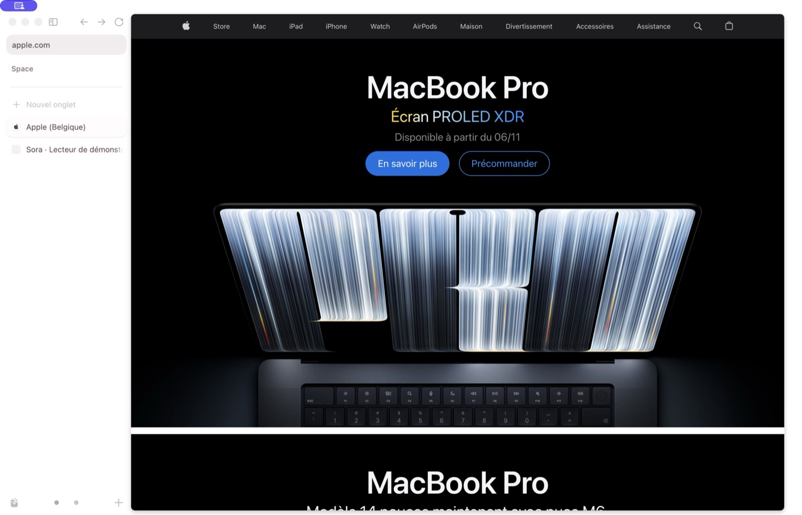

<!-- This Source Code Form is subject to the terms of the Mozilla Public
 License, v. 2.0. https://mozilla.org/MPL/2.0/ -->

# Sora

**Sora THE Browser to replace Arc** · En développement

Un navigateur pour macOS, construit sur Zen et Gecko, avec des espaces pour organiser ses onglets et une interface qui laisse la place au Web.

[Dernière version](https://github.com/tongocharly/sora-browserr/releases/latest) · [Nouveautés](Changelog) · [Signaler un problème](https://github.com/tongocharly/sora-browserr/issues)

 

*Une capture réelle de Sora. Les données affichées proviennent d’une session de démonstration.*

## Sora 0.3

- **Traduction dans la page — Bêta.** Clic droit → « Traduire la page en français », ou ouverture des paramètres du site à côté de Copier l’adresse. La langue se choisit dans ce même menu. Les pages suivantes du site restent traduites pendant la session, sans bandeau ni demandes automatiques. Le texte est traité sur le Mac ; les modèles linguistiques sont téléchargés au premier usage.
- **Mini lecteur musical.** Aligné sur les onglets, il se fond dans la barre latérale au repos et se déploie sur fond blanc au survol ou au clavier. Les titres trop longs défilent lentement et les notes musicales animées sont conservées.
- **Onglets et espaces.** Dossiers, onglets épinglés, barre latérale réduite, aperçu des liens, vue partagée, commandes `/` et extensions compatibles avec Gecko.

La langue par défaut de traduction se règle dans **Réglages → Sites**. « Afficher l’original » arrête la traduction du site. Les choix privés sont isolés et oubliés à la fermeture de la dernière fenêtre privée.

## Installer et mettre à jour

Sora fonctionne sur **macOS 15 ou plus récent**, avec **Intel et Apple Silicon**.

Depuis Sora 0.2.9 ou une version ultérieure : **Réglages → À propos → Rechercher les mises à jour**, puis confirmer l’installation. La recherche peut aussi s’effectuer automatiquement. Chaque version dispose de sa propre release GitHub ; les publications précédentes sont conservées.

Pour une première installation, l’installateur macOS de [Sora 0.2.9](https://github.com/tongocharly/sora-browserr/releases/tag/v0.2.9) permet ensuite de recevoir les mises à jour en ligne. Les paquets de mise à jour et leur catalogue sont signés. La version 0.3 ne remplace pas les fichiers des releases 0.2.9 et 0.2.9.1.

**Version d’essai signée Apple Development, non notariée.** Les protections de macOS peuvent empêcher son ouverture sur un autre Mac. Sora reste en bêta.

## Sources et Xcode

L’archive **Sora-0.3.0-sources.zip**, disponible dans la release correspondante, contient les sources et les correctifs de Sora, le projet `Sora.xcodeproj` et les instructions `SORA.md`. Elle constitue la référence correspondant au binaire distribué. Le moteur Gecko est récupéré depuis la révision indiquée dans ces sources ; il n’est pas fourni dans le ZIP de l’application.

Le projet Xcode propose des schémas distincts pour Intel et Apple Silicon et délègue la compilation aux outils Zen/Gecko. Les clés privées de signature, les profils de navigation et les caches de compilation ne font jamais partie des sources publiées.

## Crédits et licences

Sora repose sur [Zen Browser](https://github.com/zen-browser/desktop) et [Mozilla Firefox / Gecko](https://firefox-source-docs.mozilla.org/), sous les licences applicables, notamment MPL-2.0. Les mises à jour utilisent [Sparkle](https://sparkle-project.org/). Les crédits et notices de ces projets sont conservés dans les sources et dans l’application.
